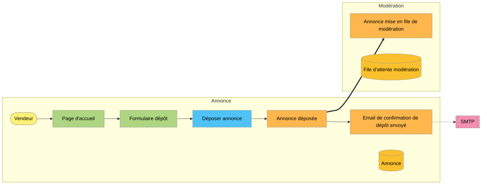
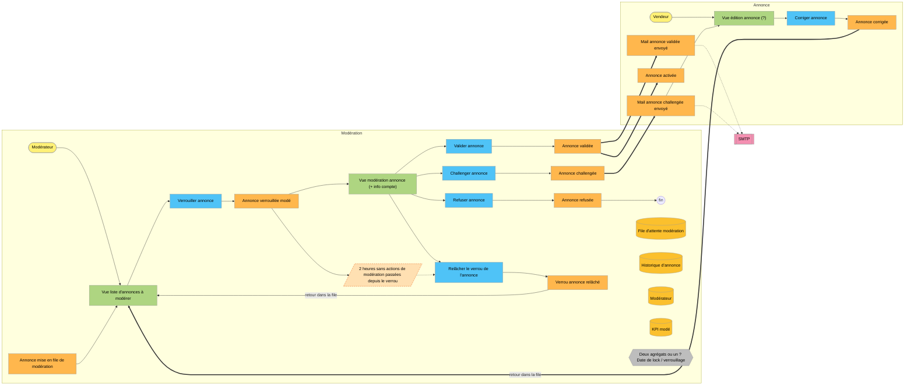
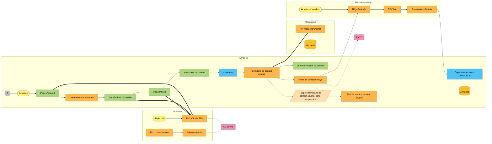
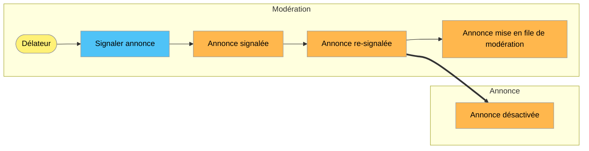
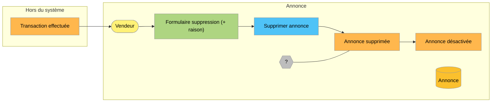
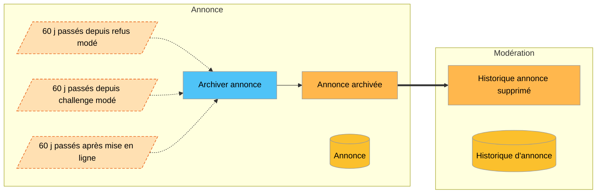

# Event storming

Transcription du mur de l'atelier (18 et 19 novembre 2026), parcours par parcours. Les photos
d'origine sont à côté : [`mur-1-gauche.jpg`](mur-1-gauche.jpg), [`mur-2-droite.jpg`](mur-2-droite.jpg),
[`mur-3-agregats.jpg`](mur-3-agregats.jpg).

**Ce fichier est une trace d'atelier, pas le modèle.** Le texte des post-its est recopié, sauf là où le groupe a précisé un terme depuis.
Le vocabulaire qui fait foi est celui de [`domain.md`](../glossary/domain.md) : un terme n'y entre
que lorsqu'on attaque son parcours. Un parcours ne s'implémente que si un ticket le demande, même
si le mur le décrit.

## Comment lire les diagrammes

| Post-it     | Type            | Dans un diagramme                         |
| ----------- | --------------- | ----------------------------------------- |
| Jaune       | Acteur          | `([Vendeur])`, classe `acteur`            |
| Vert        | Vue             | classe `vue`                              |
| Bleu        | Commande        | classe `commande`                         |
| Orange      | Événement       | classe `evenement`                        |
| Orange      | Tâche programmée (« 60 j passés… ») | `[/…/]`, classe `tache` |
| Jaune foncé | Agrégat         | `[(Annonce)]`, classe `agregat`           |
| Rose        | Système externe | `[[SMTP]]`, classe `externe`              |
| Gris        | Question        | `{{…}}`, classe `question`                |

- Un cadre (`subgraph`) est un **sous-domaine** : Annonce, Modération ou Publicité. Ce qui est hors
  de tout cadre est hors du système.
- `-->` : l'enchaînement sur la timeline.
- `==>` : un événement d'un sous-domaine qui en déclenche un autre **dans un autre sous-domaine**.
- `-.->` : ce qu'une tâche programmée déclenche, ou l'appel à un système externe.
- `(?)` marque une lecture incertaine de la photo.

## Vue d'ensemble

| Sous-domaine | Acteurs              | Agrégats                                                                | Système externe |
| ------------ | -------------------- | ----------------------------------------------------------------------- | --------------- |
| Annonce      | Vendeur, Acheteur    | Annonce                                                                 | SMTP            |
| Modération   | Modérateur, Délateur | File d'attente modération, Historique d'annonce, Modérateur, KPI modé   |                 |
| Publicité    | Régie pub            | aucun sur le mur                                                        | AD-Server       |

La timeline traverse les sous-domaines à huit moments. Ce sont les seuls points de contact entre
eux :

| Dans…      | il se produit…                                    | ce qui déclenche, dans… | …                              | Parcours |
| ---------- | ------------------------------------------------- | ----------------------- | ------------------------------ | -------- |
| Annonce    | Annonce déposée                                   | Modération              | Annonce mise en file de modération | 1   |
| Modération | Annonce validée                                   | Annonce                 | Annonce activée                | 2        |
| Modération | Annonce challengée                                | Annonce                 | Mail annonce challengée envoyé | 2        |
| Annonce    | Annonce corrigée                                  | Modération              | retour dans la file            | 2        |
| Annonce    | Page d'accueil, résultats de recherche, annonce vus | Publicité             | Pub affichée                   | 3        |
| Annonce    | Formulaire de contact soumis                      | Modération              | KPI modé incrémenté            | 3        |
| Modération | Annonce re-signalée                               | Annonce                 | Annonce désactivée             | 4        |
| Annonce    | Annonce archivée                                  | Modération              | Historique annonce supprimé    | 6        |

## Parcours

Le mur modélise l'ensemble ; l'implémentation se fait bout par bout, ticket par ticket.

| #   | Parcours                        | Sous-domaines traversés         |
| --- | ------------------------------- | ------------------------------- |
| 1   | Dépôt d'annonce                 | Annonce → Modération            |
| 2   | Modération                      | Modération ⇄ Annonce            |
| 3   | Recherche, publicité et contact | Annonce → Publicité, Modération |
| 4   | Signalement                     | Modération → Annonce            |
| 5   | Suppression                     | Hors du système → Annonce       |
| 6   | Archivage (expiration)          | Annonce → Modération            |

### 1. Dépôt d'annonce

### 2. Modération

Le modérateur verrouille une annonce de la file, puis la valide, la refuse, la challenge ou relâche
le verrou. Une annonce relâchée ou corrigée repasse dans la file de modération. Une annonce refusée
ne déclenche rien : c'est de la fraude.

### 3. Recherche, publicité et contact

La négociation, le rendez-vous et la transaction se passent entre l'acheteur et le vendeur, hors du
système. Une fois la transaction effectuée, le vendeur supprime son annonce (parcours 5). La
relance à 7 jours est une tâche programmée du sous-domaine Annonce : elle part si l'annonce n'a pas
été supprimée.

### 4. Signalement

Un re-signalement déclenche deux choses en parallèle : l'annonce est désactivée (Annonce) et elle
est remise en file de modération (Modération).

### 5. Suppression

Le vendeur supprime son annonce après une transaction effectuée (parcours 3).

### 6. Archivage

L'expiration : trois tâches programmées du sous-domaine Annonce, une même commande.

Sur le troisième déclencheur, « dépôt » est barré et remplacé par « mise en ligne ». Sur les trois
post-its « Historique annonce supprimé », « archivé » est barré et remplacé par « supprimé ».

### Post-it isolé

- **Service client contacté** — événement posé seul en bas du mur, rattaché à aucun parcours.

## Agrégats

Ce que l'atelier a noté sur les post-its jaune foncé. C'est une réflexion en cours, pas un schéma.

| Sous-domaine | Agrégat                   | Contenu noté sur le mur |
| ------------ | ------------------------- | ----------------------- |
| Annonce      | Annonce                   | titre, description, prix, mail contact, pseudo, tel, date dépôt, région, dép, ville, CP, catégorie, ID (UUID), images / URL, status, `estActivée()`, expiration date |
| Modération   | File d'attente modération | rien de noté ; question « Deux agrégats ou un ? Date de lock / verrouillage » |
| Modération   | Historique d'annonce      | ID de l'annonce ; historique : date événement, type, auteur de l'annonce, modérateur |
| Modération   | Modérateur                | ID, email |
| Modération   | KPI modé                  | rien de noté |
| Publicité    | aucun sur le mur          |                         |

## Questions

Posées sur le mur (post-its gris) :

- **Deux agrégats ou un ? Date de lock / verrouillage** — sur File d'attente modération et
  Historique d'annonce.
- **« ? »** au-dessus de l'Acheteur (parcours 3) : question non notée.
- **« ? »** sous Annonce supprimée (parcours 5) : question non notée.

Relevées à la transcription :

1. **Validée et activée** — toute annonce validée est-elle activée, ou y a-t-il des cas où non ?
2. **Désactivée** — après un re-signalement (4) et après une suppression (5) : même état ?
3. **Re-signalée** — à partir de combien de signalements ?
4. **Mise en ligne** (6) — est-ce « Annonce activée » ?
5. **Relance à 7 jours** (3) — le post-it dit « form d'achat (?) soumis » : s'agit-il du formulaire
   de contact ?
6. **Délateur** — un acheteur, un visiteur, n'importe qui ?
7. **Service client contacté** — dans quel sous-domaine, déclenché par quoi ?
